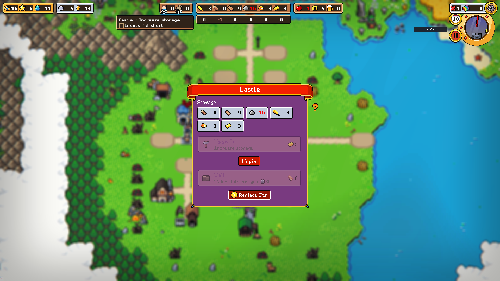
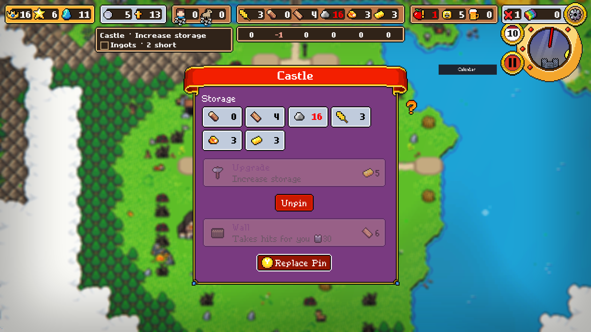

# Pin a Build Cost

Pin a building or upgrade to show its material checklist beside the resource bar. An empty box shows how much of that material is still missing. Once you have enough, the same row gains a green check and shows the fulfilled cost (for example, **Boards · 12/12**). Spending those boards reopens the box and updates the shortage. The checklist follows the current price and available stock every half second, even with the building menu closed.

**Ready** means the offer's purchase check passes. The checklist adds up entries for each material. If an offer lists 3 boards and 7 boards separately, the native purchase can accept 7 in stock. In that case the pin shows **Ready** alongside **3 short** of the combined 10. **Materials Ready · Requirements Pending** means the materials are covered but a building, kingdom or mod rule still blocks the offer. **Cost Unavailable** means the mod could not read a valid price.

## The Castle

**Increase storage** and **Wall** each have their own pin button. You can pin a greyed-out purchase while collecting materials. Only one upgrade is tracked at a time. Moving focus to **Replace Pin** previews the action and keeps the current checklist. Activating the button switches the pin.

**1× UI scale.** Increase storage is pinned, and the checklist shows two ingots missing. Storage offers **Unpin** and the Wall’s **Replace Pin** button has controller focus.



**1.5× UI scale.** The same Storage checklist and both Castle actions remain visible. Both screenshots came from the game at 1920 × 1080 in borderless fullscreen with simulated controller input.



## Controls

- In a panel with one building offer, use the pin shortcut from any control. For example, you can pin **Add chamber** from the Tavern's worker controls, or **Repair Church** while **Cancel** has focus. The default is **Y** on Xbox, **Triangle** on PlayStation, or **Tab** on keyboard. The prompt follows the game's UI/Tab binding. If a panel disables that action and your binding uses a custom interaction such as hold or release, use click or focused confirm on the pin button.
- In a list with several offers, the shortcut follows the focused card. With keyboard and mouse, it can also follow a hovered card when no card has focus. Only the target shows the shortcut. Moving focus to another panel hides it. The Outpost bonus list keeps its native controls.
- You can also click **Pin Cost**, or focus it and use the normal UI confirm action. Look beside **Upgrade**, between the actions in a world-site confirmation, or below a construction card. The pin button stays available when the purchase is unaffordable. Pinning keeps the menu open.
- **Replace Pin** switches to another target. **Unpin** removes the current target. A construction pin clears when that building design is built at any plot. An upgrade pin follows the chosen building instance and level. Leaving the menu or reaching **Ready** keeps the pin.
- A pin lasts for the current play session. Loading a run clears it. Demolishing a building clears its upgrade pin. Removing a pinned design from the active construction roster clears its pin, so another variant cannot silently inherit it.

## Compatibility

Construction pins use the actual prefab on each native card. Buildings added to that list can be pinned without registering their names or resource types. Standard upgrade pins read the price for the chosen building, upgrade and tier. If a mod adds a second upgrade at the same tier, each choice keeps its own price when you revisit the menu. Dedicated hooks also cover capacity purchases, evolution outposts and supported world-site repair, rebuild and unlock dialogs.

Mods that adjust the game's price, available-stock or construction-eligibility methods are reflected in the pin. The witch's bonfire unlock uses the star quote from the most recently opened dialog. Mods with their own menus, private inventories or purchase-only discounts can optionally use `PinABuildCost.PinCostApi.Attach` when drawing the card. Supply a stable owner and a mod-qualified operation ID, a current price getter and a completion check. Optional stock and eligibility getters let the pin use the same rules as the purchase.

Evolution pins follow the unit and the selected Outpost plot. Using that plot for another unit retires its pin. Removing a starting-resource upgrade tier also retires its pin. When filtering or recycling an individual card or its purchase control, call `Attach` again when drawing its next offer. A custom `readStock` wallet must cover the combined price even during global free building. Integrations whose purchases waive that wallet can pass `honorFreeBuilding: true` to the extended overload. Additional eligibility rules still apply.

The pin uses the game's button artwork and focus highlight. When another action occupies the space beside a purchase, the pin uses its own row. The HUD uses the resource bar's frame and font, lets pointer input pass through, and leaves room for the building panel, header controls and Daybook ledger. If neither side has enough space, the readout hides until room opens up. The target stays pinned.

## Local import

1. Coordinate a free test session if others are using the game. In Thunderstore Mod Manager, select **Super Fantasy Kingdom** and a disposable test profile.
2. Use **Settings → Import local mod**, then choose `dist/PinABuildCost-0.1.0.zip`. Confirm the mod and both BepInEx dependencies are enabled. Enable Daybook in the same profile for the HUD check.
3. Use **Start modded** and open a building plot. Each offered building should have a **Pin Cost** action. Look for `Pin a Build Cost 0.1.0 ready.` in the BepInEx log.

## Controller playtest

1. Using only a controller, open a plot and navigate to an unaffordable building. Verify the pin prompt and focus highlight. Activate the pin once. The build menu stays open and no materials are spent. Check normal navigation, tab switching, confirm and back.
2. Close and reopen the list. Compare the HUD with the card cost minus available stock. Pin a different building, then unpin it. Pin again and build something unrelated. The original target should remain.
3. Meet one material requirement and check that its row stays in place with a green check. Meet the rest to reach **Ready**, then spend one material. Only its box should reopen. Complete the pinned building and check the panel disappears.
4. Pin an upgrade. Check the building name, upgrade name and target level. Upgrade another instance first, then the pinned instance. Only the latter should clear the pin. Repeat on a small building with a scaling price when available.
5. Switch to keyboard and mouse. Use Tab on a focused or hovered card, then click its pin row. Switch back to the controller and check the prompt updates. Try ordinary confirm on the separate pin row.
   For both input schemes, focus a Tavern worker control and pin **Add chamber**. Open **Repair Church**, focus **Cancel**, replace the pin and then unpin it. Each press should change the pin once, retain focus and leave the purchase untouched. Open the Outpost bonus list and move between its bonus cards.
6. Start in **Windowed Full Screen**. At UI scales **1** and **1.5**, pin a long target name with several missing materials. Expand the Daybook ledger and food breakdown together. Check that the counts, pin and ledger remain readable. With Production Bottlenecks enabled, open a blocked building and check that its status and the native Upgrade control stay in place.

## Build and offline checks

The Release project references the installed game's managed assemblies and BepInEx core in an existing profile. The checks use 64-bit Python and the game's embedded Mono runtime in a separate process.

```powershell
dotnet build tests/PinChecks.csproj -c Release
python tests/run.py
python package.py
```

The default paths use the Steam install on D: and the local Daybook Dev profile. For other paths, pass `-p:GameDir="..."` and `-p:ProfileDir="..."` to the build and `--game "..." --profile "..."` to the check runner. Offline checks cover changing prices and stock, eligibility, pin identity and completion, and installing the shipped Harmony hooks against game 0.8.068. Embedded Mono can report unresolved Unity internal calls outside a scene. A successful check run exits with code 0. The controller playtest above requires a running game.

## Contributing and license

Bug reports and pull requests are welcome. See the [contribution guide](CONTRIBUTING.md) for local testing and reporting instructions.

The original mod code is available under the [MIT License](LICENSE). Super Fantasy Kingdom, its game assets, and third-party dependencies retain their respective licenses and ownership.
