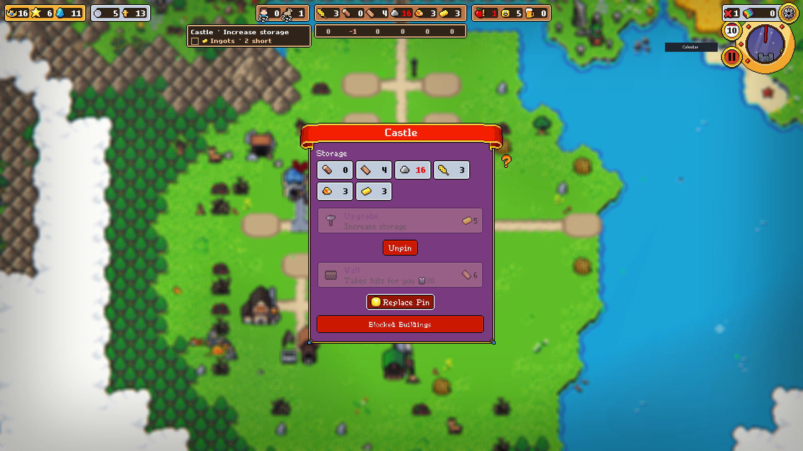

# Pin a Build Cost

Pin a building or upgrade to keep its material checklist beside the resource bar while you play. Close the building panel and you can still see what you need before you return to buy it.

## Features

- Track one purchase at a time, including an unaffordable upgrade such as the Castle’s **Increase storage** or **Wall**.
- The checklist uses the same material icons as the purchase card when space allows. Each material gets a green check when you have enough. Spend some of it and the row shows how much you still need. The checklist refreshes every half second.
- **Ready** means the purchase check passes. **Requirements Pending** means you have the materials but another rule still blocks the purchase.
- Building the tracked design on any plot clears a construction pin. An upgrade pin clears when that purchase completes on the chosen building. Demolishing a building also clears its upgrade pin.
- Continuing a kingdom restores the pin from its saved checkpoint at the current price. Replaying an earlier dawn restores that dawn’s pin. Old saves without a pin and new runs start empty.

## How to Use

1. Open a construction card or supported upgrade and choose **Pin Cost**. Click it with the mouse, or focus it with a controller and use the game’s confirm button.
2. For the shortcut, focus the offer and press **Tab** on keyboard, **Y** on Xbox, or **Triangle** on PlayStation by default. A panel with one offer also accepts the shortcut from another control, such as **Cancel** in Repair Church.
3. Choose **Replace Pin** on another offer to switch targets. Moving focus there keeps your original pin until you activate the button. Choose **Unpin** on the tracked offer to clear it. Your selection is recorded the next time the game saves a checkpoint.

## Screenshots

Captured in version 0.2.1 at 1920 × 1080 in borderless fullscreen with a virtual Xbox-style controller. The second capture uses a copied kingdom with two boards added for the Ready check.

**1× UI scale.** Storage needs five ingots and the kingdom has three. The checklist shows two missing while Wall offers **Replace Pin**.

**1.5× UI scale.** Wall is pinned after Continue. The six boards cover its full cost, and the checklist clears the Castle title ribbon.

## Compatibility

- Tested on Super Fantasy Kingdom 0.8.068. The checklist follows changes to the game’s prices, available stock and purchase rules. Mods with private inventories or their own purchase menus can add pin support through the optional integration API. If a price cannot be read, the checklist shows **Cost Unavailable**.
- With [Daybook](https://thunderstore.io/c/super-fantasy-kingdom/p/GKJ/Daybook/) 0.4.2 and [Production Bottlenecks](https://thunderstore.io/c/super-fantasy-kingdom/p/GKJ/ProductionBottlenecks/) 0.2.2, opening the ledger or the Blocked Buildings list preserved the pin at both UI scales.
- With [LoneBonfire](https://thunderstore.io/c/super-fantasy-kingdom/p/ownlyme/LoneBonfire/) 1.1.1, a second Bonfire shows **Requirements Pending** when you have enough materials but already own a Bonfire.
- With [CheatMenu](https://thunderstore.io/c/super-fantasy-kingdom/p/ILM/CheatMenu/) 1.0.3, a doubled coin award reduced the pinned shortage by the full amount received.
- On game 0.8.067, [DemolishAll](https://thunderstore.io/c/super-fantasy-kingdom/p/sfkbutter/DemolishAll/) 1.0.3 failed to add its demolition button, so that action could not be tested. The game’s own demolition action cleared the demolished building’s upgrade pin.
- If a purchase lists one material twice, the checklist shows its combined total. **Ready** still follows the game’s purchase check, which can accept the two entries separately.
- The shortcut follows the game’s UI/Tab binding. If a panel disables that action and your binding uses a custom hold or release, click the pin button or use focused controller confirm.
- The HUD leaves room for native controls. If neither side has enough space, the checklist hides until space opens up and the target stays pinned.
- If another mod supplies a private purchase, reopen its card after continuing so it can provide its price and inventory again. The pin can return when the same owner and purchase can be identified.

## Installation

1. Select **Super Fantasy Kingdom** and your profile in Thunderstore Mod Manager. Use **Install with App** on this listing.
2. Allow the manager to install [BepInExPack](https://thunderstore.io/c/super-fantasy-kingdom/p/BepInEx/BepInExPack/) and [HideManagerGameObject_Config](https://thunderstore.io/c/super-fantasy-kingdom/p/BepInEx/HideManagerGameObject_Config/), then launch the modded game.

## Support

[Support GKJ Games on Ko-fi](https://ko-fi.com/gkj_games)
