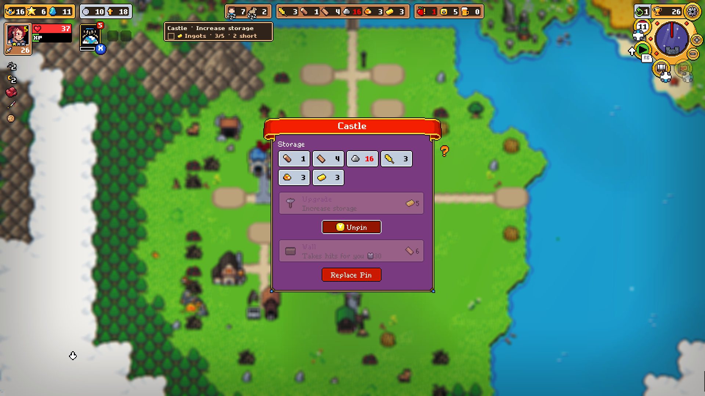
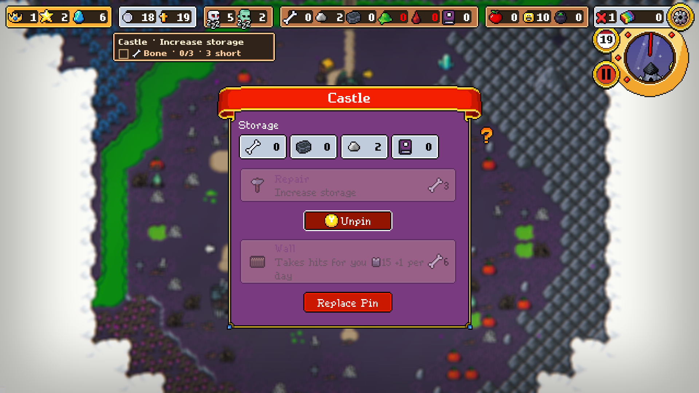

# Pin a Build Cost

Pin a building or upgrade to keep its material checklist beside the resource bar while you play. Close the building panel and you can still see what you need before you return to buy it.

## Features

- Track one purchase at a time, including an unaffordable upgrade such as the Castle’s **Increase storage** or **Wall**.
- Each checklist row shows how much you have, the full cost, and any shortage. A check appears when you have enough, and the checklist uses the purchase card’s material icons when space allows.
- **Ready** means the purchase check passes. **Requirements Pending** means you have the materials but another rule still blocks the purchase.
- Building the tracked design on any plot clears a construction pin. An upgrade pin clears when that purchase completes on the chosen building. Demolishing a building also clears its upgrade pin.
- Continuing a kingdom restores the pin from its saved checkpoint at the current price. Replaying an earlier dawn restores that dawn’s pin. Old saves without a pin and new runs start empty.

## How to Use

1. Open a construction card or supported upgrade and choose **Pin Cost**. Click it with the mouse, or focus it with a controller and use the game’s confirm button.
2. For the shortcut, focus the offer and press **Tab** on keyboard, **Y** on Xbox, or **Triangle** on PlayStation by default. A panel with one offer also accepts the shortcut from another control, such as **Cancel** in Repair Church.
3. Choose **Replace Pin** on another offer to switch targets. Moving focus there keeps your original pin until you activate the button. Choose **Unpin** on the tracked offer to clear it. Your selection is recorded the next time the game saves a checkpoint.

## Screenshots

**Human, 1× UI scale.** The restored Storage pin shows three of five ingots. Wall offers **Replace Pin**.

**Undead, 1.5× UI scale.** The restored Storage pin shows zero of three bone. **Unpin** is focused.

Captured on game 0.8.070 at 1920 × 1080 with virtual controller input.

## Compatibility

- Built for Super Fantasy Kingdom **0.8.070**. Pins restore on Continue in both Human and Undead kingdoms.
- [Daybook](https://thunderstore.io/c/super-fantasy-kingdom/p/GKJ/Daybook/), [Production Bottlenecks](https://thunderstore.io/c/super-fantasy-kingdom/p/GKJ/ProductionBottlenecks/), and [Worker Presets](https://thunderstore.io/c/super-fantasy-kingdom/p/GKJ/WorkerPresets/) can share the building panel and HUD with a pin.
- With [Lone Bonfire](https://thunderstore.io/c/super-fantasy-kingdom/p/ownlyme/LoneBonfire/), a second bonfire can show **Requirements Pending** even when you have the materials.
- The checklist follows the game’s current prices, stock, and purchase rules. If a mod supplies its own purchase or inventory, reopen the offer after Continue so it can provide its cost again.
- If space is tight, the checklist hides until room opens and keeps your target pinned. If a panel blocks the shortcut, click the pin button or focus it and confirm.

## Installation

1. Select **Super Fantasy Kingdom** and your profile in Thunderstore Mod Manager. Use **Install with App** on this listing.
2. Allow the manager to install [BepInExPack](https://thunderstore.io/c/super-fantasy-kingdom/p/BepInEx/BepInExPack/) and [HideManagerGameObject_Config](https://thunderstore.io/c/super-fantasy-kingdom/p/BepInEx/HideManagerGameObject_Config/), then launch the modded game.

[Support GKJ Games on Ko-fi](https://ko-fi.com/gkj_games)
