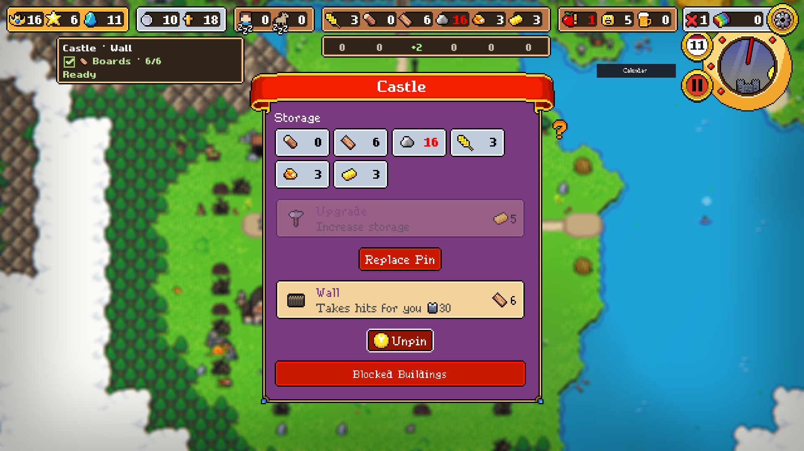

# Pin a Build Cost

Pin a building or upgrade to keep its material checklist beside the resource bar while you play. Close the building panel and you can still see what you need before you return to buy it.

## Features

- Track one purchase at a time, including an unaffordable upgrade such as the Castle’s **Increase storage** or **Wall**.
- The checklist uses the same material icons as the purchase card when space allows. Each material gets a green check when you have enough. Spend some of it and the row shows how much you still need. The checklist refreshes every half second.
- **Ready** means the purchase check passes. **Requirements Pending** means you have the materials but another rule still blocks the purchase.
- Building the tracked design on any plot clears a construction pin. An upgrade pin clears when that purchase completes on the chosen building. Demolishing a building also clears its upgrade pin.
- Continuing a kingdom restores the pin from its saved checkpoint at the current price. Replaying an earlier dawn restores that dawn’s pin. Old saves without a pin and new runs start empty.

## How to Use

1. Open a construction card or supported upgrade and choose **Pin Cost**. Click it with the mouse, or focus it with a controller and use the game’s confirm button.
2. For the shortcut, focus the offer and press **Tab** on keyboard, **Y** on Xbox, or **Triangle** on PlayStation by default. A panel with one offer also accepts the shortcut from another control, such as **Cancel** in Repair Church.
3. Choose **Replace Pin** on another offer to switch targets. Moving focus there keeps your original pin until you activate the button. Choose **Unpin** on the tracked offer to clear it. Your selection is recorded the next time the game saves a checkpoint.

## Screenshots

**1× UI scale.** Storage needs five ingots and the kingdom has three. The checklist shows two missing while Wall offers **Replace Pin**.

**1.5× UI scale.** Wall is pinned after Continue. The six boards cover its full cost, and the checklist clears the Castle title ribbon.

## Compatibility

- Works with Super Fantasy Kingdom **0.8.068** and the other [GKJ mods](https://thunderstore.io/c/super-fantasy-kingdom/p/GKJ/).
- The checklist follows the game’s current prices, stock, and purchase rules. Extra purchase rules can show **Requirements Pending** even when you have the materials.
- [Daybook](https://thunderstore.io/c/super-fantasy-kingdom/p/GKJ/Daybook/), [Production Bottlenecks](https://thunderstore.io/c/super-fantasy-kingdom/p/GKJ/ProductionBottlenecks/), and [Worker Presets](https://thunderstore.io/c/super-fantasy-kingdom/p/GKJ/WorkerPresets/) can share the building panel and HUD with a pin.
- With [Lone Bonfire](https://thunderstore.io/c/super-fantasy-kingdom/p/ownlyme/LoneBonfire/), a second bonfire can still show **Requirements Pending**. Mods that manage their own prices or inventory can supply pin support. Reopen the offer after Continue if it needs to provide its cost again.
- If space is tight, the checklist hides until room opens and keeps your target pinned. If a panel blocks the shortcut, use the pin button or focus it and confirm.
- These community mods can share the same profile. [Achievement Enabler](https://thunderstore.io/c/super-fantasy-kingdom/p/ownlyme/AchievementEnabler/), [Bakery Uses Wheat](https://thunderstore.io/c/super-fantasy-kingdom/p/ownlyme/BakeryUsesWheat/), [More Relics](https://thunderstore.io/c/super-fantasy-kingdom/p/ownlyme/MoreRelics/), [Right Click Skip](https://thunderstore.io/c/super-fantasy-kingdom/p/ownlyme/RightClickSkip/), and [Tavern Food Priorities](https://thunderstore.io/c/super-fantasy-kingdom/p/ownlyme/TavernFoodPriorities/).

## Installation

1. Select **Super Fantasy Kingdom** and your profile in Thunderstore Mod Manager. Use **Install with App** on this listing.
2. Allow the manager to install [BepInExPack](https://thunderstore.io/c/super-fantasy-kingdom/p/BepInEx/BepInExPack/) and [HideManagerGameObject_Config](https://thunderstore.io/c/super-fantasy-kingdom/p/BepInEx/HideManagerGameObject_Config/), then launch the modded game.

## Support

[Support GKJ Games on Ko-fi](https://ko-fi.com/gkj_games)
