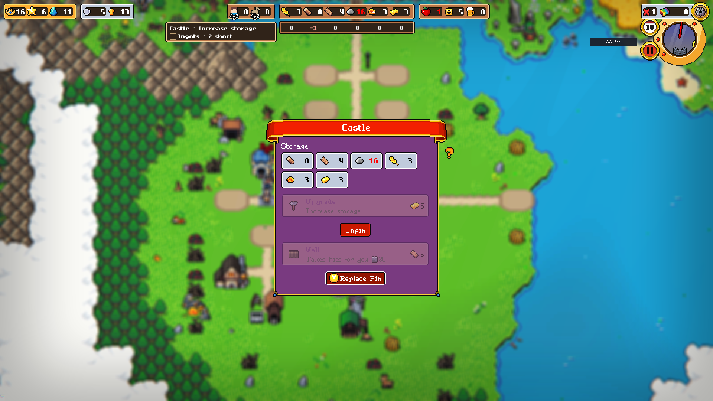
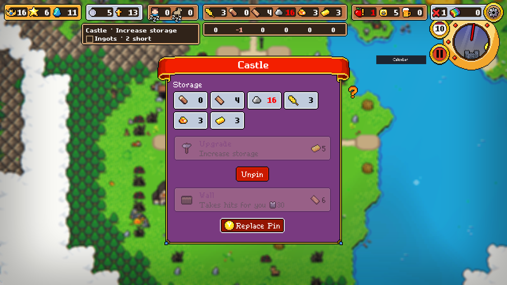

Pin a building or upgrade to keep its material checklist beside the resource bar while you play. Close the building panel and you can still see what you need before you return to buy it.

## Features

- Track one purchase at a time, including an unaffordable upgrade such as the Castle’s **Increase storage** or **Wall**.
- Each material gets a green check when you have enough. Spend some of it and the row shows how much you still need. The checklist refreshes every half second.
- **Ready** means the purchase check passes. **Materials Ready · Requirements Pending** means you have the materials but another rule still blocks the purchase.
- Completing the pinned build or upgrade clears the checklist. Demolishing a building also clears its upgrade pin.

## How to Use

1. Open a construction card or supported upgrade and choose **Pin Cost**. Click it with the mouse, or focus it with a controller and use the game’s confirm button.
2. For the shortcut, focus the offer and press **Tab** on keyboard, **Y** on Xbox, or **Triangle** on PlayStation by default. A panel with one offer also accepts the shortcut from another control, such as **Cancel** in Repair Church.
3. Choose **Replace Pin** on another offer to switch targets. Moving focus there keeps your original pin until you activate the button. Choose **Unpin** on the tracked offer to clear it. Loading a run also clears the pin.

## Screenshots

Both captures show version 0.1.0 in-game at 1920 × 1080 in borderless fullscreen with simulated controller input.

**1× UI scale.** The checklist shows **Ingots · 2 short**, and **Unpin** beneath Increase storage identifies the tracked upgrade.

**1.5× UI scale.** The white outline shows focus on the Wall’s **Replace Pin** button. The checklist above still tracks Increase storage.

## Compatibility

Tested on Super Fantasy Kingdom 0.8.068. The checklist works alongside **Daybook** and **Production Bottlenecks**. It follows changes to native prices, available stock and purchase rules. Mods that use their own purchase menus or private inventories can add pin support through the optional integration API.

The shortcut follows the game’s UI/Tab binding. If a panel disables that action and your binding uses a custom hold or release, click the pin button or use focused controller confirm.

## Installation

1. Select **Super Fantasy Kingdom** and your profile in Thunderstore Mod Manager. Use **Install with App** on this listing.
2. Allow the manager to install **BepInExPack** and **HideManagerGameObject_Config**, then launch the modded game.
